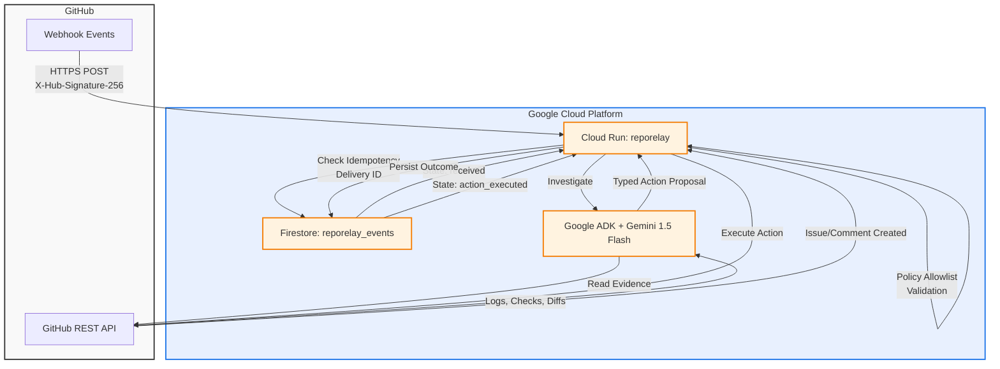

# RepoRelay Architecture Diagram



## Component Details

### Event Flow

1. **GitHub Webhook** → Cloud Run `/events/github`
   - Events: `workflow_job`, `check_run`, `pull_request`
   - Signature verification (HMAC SHA256)

2. **Normalization** → `NormalizedEvent` dataclass
   - Extracts repository, commit, job/check/PR data
   - Unified schema for all event types

3. **Idempotency Check** → Firestore
   - Key: GitHub `X-GitHub-Delivery` header
   - States: `received` → `investigating` → `action_proposed` → `action_executed` | `failed` | `needs_human`

4. **Investigation** → Google ADK Agent
   - Gemini 1.5 Flash model
   - Tools: GitHub read operations (logs, checks, files, diffs)
   - Output: Typed `ActionProposal` JSON

5. **Policy Validation** → Deterministic Allowlist
   - Only `create_issue`, `update_issue`, `create_pr_comment`, `update_pr_comment`
   - Required labels/markers enforced
   - Rejects malformed or unsafe proposals

6. **Execution** → GitHub API
   - Creates/updates triage issue (`reporelay-triage` label)
   - Creates/updates PR comment (`reporelay-readiness` marker)
   - Idempotent: finds existing by commit SHA or marker

7. **State Persistence** → Firestore
   - Records outcome, GitHub IDs, evidence refs
   - Enables retry, audit, demo replay

### Data Models

```
EventRecord (Firestore)
├── delivery_id (PK)
├── event_type
├── repository
├── state: received | investigating | action_proposed | action_executed | failed | needs_human
├── created_at, updated_at
├── payload_hash
├── action_taken
├── action_result
├── error
├── retryable: yes | no | unknown
├── retry_count
├── github_issue_number
└── github_comment_id
```

### Safety Boundaries

| Allowed | Forbidden (v1) |
|---------|----------------|
| Read repo metadata | Merge PRs |
| Read commits/diffs | Push code |
| Read CI/check data | Force-push |
| Read bounded logs | Change branch protection |
| Create/update triage issue | Modify repo settings |
| Create/update PR comment | Publish releases |
| Apply `reporelay-*` labels | Delete branches/issues |
| Persist workflow state | Rotate credentials |

### Deployment Topology

```
┌─────────────────────────────────────────────────────────────┐
│                     Cloud Run (us-central1)                 │
│  ┌─────────────────────────────────────────────────────┐   │
│  │  Container: python:3.12-slim                         │   │
│  │  - FastAPI app (uvicorn, 1 worker)                  │   │
│  │  - Google ADK agent (Gemini 1.5 Flash)              │   │
│  │  - PyGithub client (App auth)                       │   │
│  │  - Firestore client                                 │   │
│  └─────────────────────────────────────────────────────┘   │
│                         │                                   │
│         ┌───────────────┼───────────────┐                   │
│         ▼               ▼               ▼                   │
│    ┌─────────┐    ┌─────────────┐ ┌──────────┐             │
│    │ Firestore│    │ GitHub API  │ │ Vertex AI│             │
│    │ (state)  │    │ (actions)   │ │ (Gemini) │             │
│    └─────────┘    └─────────────┘ └──────────┘             │
└─────────────────────────────────────────────────────────────┘
```

### Scaling & Reliability

- **Cloud Run**: Auto-scales 0-N instances, concurrency 80
- **Firestore**: Strong consistency, automatic indexing
- **Retries**: Bounded exponential backoff (max 3, base 1s)
- **Timeouts**: Webhook 10s, GitHub API 30s, Gemini 60s
- **Monitoring**: Cloud Logging, Cloud Trace, Error Reporting